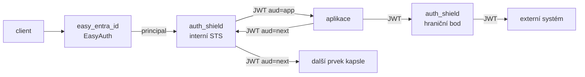

# Auth Shield

Transparentní autentizační mezivrstva mezi `easy_entra_id` (EasyAuth), aplikacemi
a `serverjsonata`. Aplikace nikdy nedostane samotnou Entra identitu — dostane
krátkodobý opaque handle, který Shield umí přeložit zpět.

> ⚠️ `TokenVault` je procesně lokální. Musí běžet **právě jeden** Uvicorn
> worker, jinak se handle vydaný jedním workerem v jiném nenajde.

> 📄 Chystaná změna: varianta, kde Shield vystupuje jako interní STS a vydává
> ověřitelné JWT, je popsaná v [Návrh: Shield jako interní STS](#návrh-shield-jako-interní-sts).
> Aktuální kód se podle ní zatím nechová.

## Dva směry provozu

```text
Externí směr (klient -> aplikace)

  client
    -> easy_entra_id (EasyAuth)
    -> auth_shield /{app_id}/{path}
    -> registrovaná aplikace /{path}

Interní směr (aplikace -> serverjsonata)

  aplikace
    -> auth_shield /{path}
    -> serverjsonata /{path}
```

Směr se určuje **výhradně z hlaviček** requestu, ne z cesty:

| Podmínka | Směr |
| --- | --- |
| `Authorization: Bearer shld_...` | interní (corridor) |
| `x-ms-client-principal*` | externí (EasyAuth) |
| obojí současně | 500 – ambiguous contract |
| ani jedno | 500 – unknown contract |

Neplatný nebo chybějící EasyAuth kontrakt je brán jako chyba infrastruktury
(gateway), proto 500 a ne 401.

## Co Shield dělá

### Externí směr

1. Ověří EasyAuth kontrakt (`x-ms-client-principal` musí být base64 JSON objekt,
   `principal_id` se bere z hlavičky nebo z claimu `oid`/`sub`).
2. Rozdělí cestu na `app_id` a zbytek (`/whoami/api/x` → `whoami` + `api/x`).
3. Ověří, že aplikace existuje, je `enabled` a povoluje danou HTTP metodu.
4. Uloží principal do `TokenVault` a vydá handle `shld_<32B urlsafe>`.
5. Přepošle request na `upstream` aplikace s hlavičkami:

```text
Authorization: Bearer shld_...
x-shield-app                 app_id
x-shield-principal-id        oid uživatele
x-shield-principal-name      e-mail / UPN (pokud je)
x-shield-expires-in          TTL v sekundách
x-request-id                 z requestu, jinak vygenerovaný
```

### Interní směr

1. Podle handlu dohledá záznam ve vaultu (expirovaný/neznámý → 401).
2. Ověří aplikaci a povolenou metodu.
3. Ověří, že cesta spadá do `allowed_corridor_prefixes` (jinak 403).
4. Obnoví EasyAuth identitní hlavičky vůči `CORRIDOR_UPSTREAM`:

```text
x-ms-client-principal        původní base64 principal
x-ms-client-principal-id     oid
x-ms-client-principal-name   e-mail / UPN (pokud je)
x-shield-app                 app_id
x-shield-principal-id        oid
x-shield-principal-name      e-mail / UPN (pokud je)
x-shield-token-fingerprint   sha256(principal)[:16]
x-request-id                 z requestu, jinak vygenerovaný
```

## Bezpečnostní pravidla

- `SENSITIVE_HEADERS` (`authorization`, `cookie`, `set-cookie`, `x-ms-token-aad-*`,
  `x-ms-client-principal*`, `x-shield-*`) se z příchozího requestu **nikdy**
  nepropouští na upstream — klient je nemůže podstrčit.
- Hop-by-hop hlavičky (`connection`, `transfer-encoding`, `upgrade`, …) se
  zahazují v obou směrech.
- `Host` se přepisuje na host upstreamu.
- `Set-Cookie` z upstreamu se do odpovědi nepropouští.
- Odpověď se streamuje a hlídá se `MAX_RESPONSE_BYTES`.
- `docs_url`/`redoc_url` jsou vypnuté.

## Konfigurace

| Proměnná | Default | Význam |
| --- | --- | --- |
| `APPLICATIONS_JSON` | — (**povinné**) | Registr aplikací |
| `CORRIDOR_UPSTREAM` | `http://serverjsonata:3000` | Cíl interního směru |
| `TOKEN_TTL_SECONDS` | `300` | Platnost handlu |
| `MAX_TOKEN_ENTRIES` | `10000` | Max. záznamů ve vaultu |
| `REQUEST_TIMEOUT_SECONDS` | `60` | Timeout na upstream |
| `MAX_RESPONSE_BYTES` | `52428800` (50 MiB) | Limit streamované odpovědi |
| `LOG_LEVEL` | `INFO` | Úroveň logování |

### `APPLICATIONS_JSON`

```json
{
  "whoami": {
    "upstream": "http://whoami",
    "enabled": true,
    "allowed_methods": ["GET", "POST", "PUT", "PATCH", "DELETE", "OPTIONS", "HEAD"],
    "allowed_corridor_prefixes": ["/graphql"]
  },
  "graphql": {
    "upstream": "http://serverjsonata:3000/graphql",
    "allowed_methods": ["POST"],
    "allowed_corridor_prefixes": ["/graphql"]
  }
}
```

| Pole | Povinné | Default |
| --- | --- | --- |
| `upstream` | ano | — |
| `enabled` | ne | `true` |
| `allowed_methods` | ne | všechny podporované |
| `allowed_corridor_prefixes` | ne | `["/graphql"]` |

Validace je striktní: neznámá metoda, neabsolutní prefix, prázdný `upstream`
nebo prázdný registr shodí start aplikace s `RuntimeError`.

## Endpointy

| Metoda | Cesta | Popis |
| --- | --- | --- |
| `GET` | `/health` | `ok`, seznam aplikací, počet záznamů ve vaultu |
| `*` | `/{path}` | Catch-all proxy (externí i interní směr) |

## Spuštění

### Docker Compose

```bash
docker compose -f docker-compose.fake-shield.yaml up --build
```

- shield: <http://localhost:8090>
- fake login: <http://localhost:8088>

Varianta s `serverjsonata` a UI:

```bash
docker compose -f docker-compose.fake-shield.ext.yaml up --build
```

### Lokálně

```bash
pip install -r auth_shield/requirements.txt

export APPLICATIONS_JSON='{"whoami":{"upstream":"http://localhost:8080"}}'
export CORRIDOR_UPSTREAM='http://localhost:3000'

uvicorn main:app --host 0.0.0.0 --port 8000 --app-dir auth_shield
```

### Z publikované image

```bash
docker run --rm -p 8090:8000 \
  -e APPLICATIONS_JSON='{"whoami":{"upstream":"http://whoami"}}' \
  ghcr.io/hrbolek/easy_entra_id-auth-shield:latest
```

## Rychlé ověření

```bash
# health
curl http://localhost:8090/health

# externí směr: EasyAuth principal (base64 JSON)
PRINCIPAL=$(printf '%s' '{"auth_typ":"aad","claims":[{"typ":"oid","val":"abc-123"}]}' | base64 -w0)
curl -i http://localhost:8090/whoami/api \
  -H "x-ms-client-principal: $PRINCIPAL" \
  -H "x-ms-client-principal-id: abc-123"

# interní směr: neplatný handle -> 401
curl -i http://localhost:8090/graphql -H "Authorization: Bearer shld_bogus"

# bez identity -> 500 (unknown contract)
curl -i http://localhost:8090/whoami/api
```

## Omezení

- `TokenVault` je v paměti procesu → jeden worker, žádné sdílení mezi
  replikami; pro HA je potřeba Redis/Valkey.
- Handle nelze obnovit po restartu procesu (uživatel musí projít znovu
  přes EasyAuth).
- `Set-Cookie` se nepropouští, takže Shield není vhodný pro aplikace, které
  staví session na cookies z upstreamu.
- Není to OIDC server — Shield jen konzumuje EasyAuth kontrakt.

---

## Návrh: Shield jako interní STS

> **Stav: návrh, neimplementováno.** Tato sekce popisuje cílový stav. Aktuální
> kód v `main.py` používá opaque handle a `TokenVault` popsaný výše.

### Motivace

Opaque handle má tři slabiny:

1. **Validace jen dotazem do vaultu** — každý request znamená lookup, takže
   Shield nemůže běžet ve více replikách a je to SPOF.
2. **Nestandardní kontrakt** — aplikace musí umět `shld_...`, nemůže použít
   hotový JWT middleware.
3. **Autorizace až za proxy** — `roles`/`scp` nejsou v ruce volajícího, takže
   se rozhoduje jen podle `x-shield-*` hlaviček.

Cílový stav: Shield je **interní STS** (security token service). Vydává
standardní RS256 JWT, které si každý člen kapsle ověří sám přes JWKS.

### Klíčové rozhodnutí: symetrická hranice kapsle

Kapsle = množina služeb za `auth_shield`. Na **obou** hranicích se mluví JWT:



- **Dovnitř** — Shield ověří EasyAuth principal a vydá JWT pro cílovou aplikaci.
- **Uvnitř** — aplikace volá další prvek kapsle s JWT; Shield ho ověří a vydá
  **nový** JWT s `aud` cíle.
- **Ven** — volající pošle JWT, Shield ho ověří a předá dál JWT (ne původní
  Entra token).

### Proč se nevrací původní Entra token

Výměna JWT zpět za původní Entra access token je **token passthrough** a je to
anti-pattern:

- příjemce nemá jak poznat, pro koho byl token vydán (audience confusion),
- token uniklý z jedné služby jde zneužít v celé kapsli i mimo ni,
- Shield by musel držet reálné credentials v paměti a řešit jejich refresh.

Symetrická hranice (JWT dovnitř, JWT ven) tento problém nemá: každý token má
jednoznačný `aud` a krátkou platnost. Pokud externí systém vyžaduje Entra token,
patří to do samostatného adaptéru s OBO flow, ne do proxy.

### Formát tokenu

```json
{
  "iss": "https://shield.internal",
  "aud": "whoami",
  "sub": "<oid>",
  "azp": "graphql",
  "act": { "sub": "<oid>" },
  "roles": ["auditor"],
  "scp": ["read:profile"],
  "tid": "<tenant>",
  "jti": "<uuid>",
  "iat": 0, "nbf": 0, "exp": 0
}
```

| Claim | Význam |
| --- | --- |
| `aud` | **Vždy** konkrétní cíl, nikdy globální hodnota |
| `azp` | Kdo token požádal (volající prvek kapsle) |
| `act` | Původní subjekt při delegaci (RFC 8693) |
| `roles` / `scp` | Autorizace dostupná lokálně bez dotazu |
| `jti` | Identifikátor pro logování a případný denylist |

### Endpointy

| Metoda | Cesta | Popis |
| --- | --- | --- |
| `GET` | `/.well-known/openid-configuration` | Discovery (`jwks_uri`, `issuer`) |
| `GET` | `/.well-known/jwks.json` | Veřejné klíče, `kid` + rotace |
| `POST` | `/auth/exchange` | Výměna JWT za JWT s jiným `aud` (RFC 8693) |
| `GET` | `/health` | Stav, seznam aplikací, `kid` v rotaci |

### Bezpečnostní pravidla

- `aud` vždy konkrétní cíl; token pro `whoami` nesmí projít do `graphql`.
- TTL 60–300 s, žádné refresh tokeny uvnitř kapsle.
- Rotace klíčů: nový `kid` se publikuje dřív, starý zůstává v JWKS po dobu
  overlapu (min. 2× TTL).
- Privátní klíč přes secret/volume, aby všechny repliky validovaly stejně.
- `/auth/exchange` musí být vázaný na volajícího (mTLS, network policy nebo
  per-app secret) — samotný JWT k výměně nestačí.
- `Authorization` nikdy do logů, logovat jen `jti` a `azp`.
- Clock skew 30–60 s.

### Dopad na dnešní kód

| Prvek | Dnes | Po změně |
| --- | --- | --- |
| `TokenVault` | nutný pro každý request | není potřeba pro interní hop |
| Počet workerů | právě 1 | libovolný (validace je lokální) |
| `x-shield-*` hlavičky | nositel identity | jen doplňkové, identita je v JWT |
| `SENSITIVE_HEADERS` | zahazuje `authorization` | `authorization` se ověřuje, ne zahazuje |

### Migrace

1. `SHIELD_TOKEN_MODE=handle|jwt|both` — handle zůstane pro zpětnou
   kompatibilitu.
2. Aplikace přejdou na lokální validaci JWT přes JWKS.
3. Handle se vypustí; `TokenVault` zůstane jen pro externí adaptér s OBO.

`fake` už dnes umí RS256, JWKS i discovery, takže slouží jako testovací IdP
a obě služby zůstanou symetrické.
