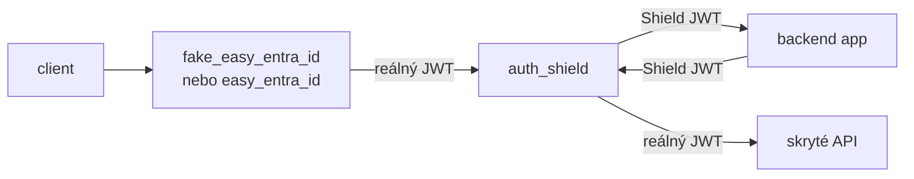

# Auth Shield

Transparentní autentizační mezivrstva mezi vydavatelem identity
(`easy_entra_id` / `fake_easy_entra_id`), backend aplikací a skrytým API.

Backend aplikace **nikdy nevidí reálný token**. Shield ho ověří, uloží do
`TokenVault` a aplikaci předá vlastní **Shield JWT**. Při volání API jde
request zase přes Shield, který Shield JWT vymění zpět za reálný token.

> ⚠️ `TokenVault` je procesně lokální. Musí běžet **právě jeden** Uvicorn
> worker, jinak se token uložený jedním workerem v jiném nenajde.

## Topologie



| Prvek | Vidí |
| --- | --- |
| `fake_easy_entra_id` / `easy_entra_id` | reálný JWT (vydává ho) |
| `auth_shield` | reálný JWT i Shield JWT |
| backend app | **jen Shield JWT** |
| skryté API | reálný JWT |

## Dva směry provozu

```text
Ingress (vydavatel -> backend aplikace)

  client
    -> easy_entra_id / fake_easy_entra_id
    -> auth_shield /{app_id}/{path}      Authorization: Bearer <reálný JWT>
    -> aplikace /{path}                  Authorization: Bearer <Shield JWT>

Egress (backend aplikace -> skryté API)

  aplikace
    -> auth_shield /{path}               Authorization: Bearer <Shield JWT>
    -> corridor upstream /{path}         Authorization: Bearer <reálný JWT>
```

Směr se určuje **výhradně z claimu `iss`** v bearer tokenu:

| `iss` v tokenu | Směr |
| --- | --- |
| `SHIELD_ISSUER` (tento Shield) | egress (corridor) |
| registrovaný vydavatel z `ISSUERS_JSON` | ingress |
| neznámý / chybějící token | 500 – unknown contract |

## Co Shield dělá

### Ingress

1. Přečte `iss` z tokenu (bez ověření podpisu) a najde odpovídajícího
   důvěryhodného vydavatele. `iss` mimo registr = 401.
2. Stáhne klíč z `jwks_uri` vydavatele podle `kid` (cache, refresh při
   neznámém `kid` s rate limitem).
3. Ověří podpis, `iss`, `aud`, `exp`, `nbf` (leeway 60 s).
4. Rozdělí cestu na `app_id` a zbytek (`/backend-app/api/x` → `backend-app`
   + `api/x`) a ověří registrovanou aplikaci i povolenou metodu.
5. Uloží **reálný token** do `TokenVault` pod nové `jti`.
6. Vydá Shield JWT a přepošle request na upstream aplikace.

Backend dostane:

```text
Authorization: Bearer <Shield JWT>
x-shield-app                 app_id
x-shield-principal-id        sub (oid uživatele)
x-shield-expires-in          TTL Shield JWT v sekundách
x-request-id                 z requestu, jinak vygenerovaný
```

### Egress

1. Ověří Shield JWT vlastním klíčem, `iss` proti `SHIELD_ISSUER` a `aud`
   proti registru aplikací.
2. Dohledá `jti` ve vaultu (expirovaný/neznámý → 401) a ověří, že `aud`
   odpovídá `app_id` záznamu.
3. Ověří povolenou metodu a že cesta spadá do `allowed_corridor_prefixes`
   (jinak 403).
4. Přiloží **reálný token** vydavatele na odchozí request.

Corridor upstream dostane:

```text
Authorization: Bearer <reálný JWT>
x-shield-app                 app_id
x-shield-principal-id        sub
x-shield-token-fingerprint   sha256(reálný token)[:16]
x-request-id                 z requestu, jinak vygenerovaný
```

## Shield JWT

Shield je pro backend **vydavatel**: podepisuje vlastní RS256 JWT, který si
backend ověří standardně přes `iss` a JWKS.

```json
{
  "iss": "https://auth-shield.dev.internal",
  "aud": "backend-app",
  "sub": "<oid>",
  "azp": "https://auth.dev.company.cz",
  "roles": ["auditor"],
  "scp": ["read:profile"],
  "tid": "<tenant>",
  "jti": "<uuid>",
  "iat": 0, "nbf": 0, "exp": 0
}
```

| Claim | Význam |
| --- | --- |
| `iss` | logická identita Shieldu (`SHIELD_ISSUER`) |
| `aud` | konkrétní aplikace, nikdy globální hodnota |
| `sub` | původní uživatel (`oid` z vydavatele) |
| `azp` | kdo identitu přinesl (`iss` vydavatele) |
| `roles` / `scp` | autorizace dostupná lokálně bez dotazu |
| `jti` | klíč do `TokenVault` s reálným tokenem |

Shield JWT **není** použitelný proti skrytému API — to přijímá jen tokeny od
skutečného vydavatele identity.

## Jak backend ověří Shield JWT

Backend potřebuje **dvě** hodnoty:

| Proměnná | K čemu |
| --- | --- |
| `SHIELD_ISSUER` | proti čemu porovná `iss` v tokenu |
| `SHIELD_JWKS_URL` | odkud si stáhne veřejné klíče |

```python
expected_iss = os.environ["SHIELD_ISSUER"]
jwks_url = os.environ["SHIELD_JWKS_URL"]

claims = jwt.decode(
    token,
    key=fetch_jwks(jwks_url),      # cache, refresh při neznámém kid
    algorithms=["RS256"],
    issuer=expected_iss,           # proti konfiguraci, ne proti tokenu
    audience="backend-app",
)
```

`jwks_uri` **není** místo validace — je to jen adresa, odkud se stáhnou klíče.
Validace probíhá lokálně v backendu.

## Volba `iss` nezávisle na nasazení

`iss` nesmí být odvozený ze síťové adresy. V docker compose je Shield dostupný
na `http://auth_shield:8000`, ale tato adresa se mění podle názvu služby,
portu, prostředí i podle toho, zda je před ním TLS terminátor.

### Co je co

| Co | K čemu slouží | Příklad |
| --- | --- | --- |
| `iss` (claim v JWT) | **identita vydavatele** — proti čemu backend porovnává | `https://auth-shield.dev.internal` |
| `jwks_uri` | **odkud stáhnout veřejné klíče** pro ověření podpisu | `http://auth_shield:8000/.well-known/jwks.json` |
| `aud` (claim v JWT) | **komu je token určen** | `backend-app` |

Validace samotná probíhá **lokálně v backendu**:

1. Backend přečte `iss` z tokenu a porovná ho s očekávanou hodnotou.
2. Stáhne klíče z `jwks_uri` (jednou, pak z cache).
3. Ověří podpis klíčem podle `kid` — lokálně, bez síťového volání.
4. Ověří `aud`, `exp`, `nbf` — také lokálně.

Síťové volání je tedy jen kvůli klíčům, ne kvůli validaci. Proto se `jwks_uri`
může měnit mezi nasazeními, aniž by to znamenalo změnu kontraktu.

### `jwks_uri` je trust anchor, ne tajemství

`jwks_uri` není heslo, které by se mělo skrývat; je to **ukazatel důvěry**.
Kdo ho změní, rozhoduje, kterým klíčům backend uvěří.

| Vlastnost | Secret (heslo, klíč) | Trust anchor (`jwks_uri`) |
| --- | --- | --- |
| Má se skrývat? | ano | ne, ale musí být **integritně chráněný** |
| Kdo ho smí měnit | nikdo mimo správce | jen konfigurace, nikdy request |
| Co hrozí při zneužití | přímý přístup | podvržené klíče → podvržené tokeny |
| Odkud se bere | secret store | konfigurace / `.env` |

Klíčový důsledek: **`jwks_uri` se nikdy nesmí vzít z tokenu ani z discovery
dokumentu, kterému ještě nevěříme.**

### Pravidla pro `jwks_uri`

- **Pevně z konfigurace**, stejně jako `iss`. Nikdy z `Host` ani z tokenu.
- **HTTPS mimo lokální síť.** `http://auth_shield:8000` je přijatelné jen
  uvnitř compose sítě.
- **Ověřit TLS certifikát** — vypnutá verifikace dělá z trust anchoru
  veřejný bod.
- **Omezit, kam se smí volat** — jen registrované JWKS adresy (jinak SSRF).
- **Cache s rozmyslem** — při neznámém `kid` refresh s rate limitem.
- **Discovery jen jako convenience** — `issuer` porovnat s vlastní hodnotou,
  `jwks_uri` ignorovat nebo ověřit proti allowlistu.

### Doporučená konvence

```text
https://auth-shield.<env>.internal
```

- `<env>` = `dev`, `test`, `prod` — prostředí v názvu brání tomu, aby token
  z dev prošel v prod i při shodném klíči,
- bez trailing slash, bez portu, bez cesty,
- vždy `https://`, i když uvnitř compose jede Shield po HTTP.

### Jediný zdroj pravdy v docker compose

```dotenv
# trust anchors — verzované, reviewované
SHIELD_ISSUER=https://auth-shield.dev.internal
SHIELD_JWKS_URL=http://auth_shield:8000/.well-known/jwks.json

# secrets — necommitovat
SHIELD_SIGNING_KEY_FILE=/run/secrets/shield-signing-key.pem
```

```yaml
services:
  auth_shield:
    environment:
      SHIELD_ISSUER: ${SHIELD_ISSUER}
      SHIELD_JWKS_BASE_URL: http://auth_shield:8000

  backend_app:
    environment:
      SHIELD_ISSUER: ${SHIELD_ISSUER}
      SHIELD_JWKS_URL: ${SHIELD_JWKS_URL}
```

`SHIELD_JWKS_BASE_URL` je jen to, co Shield vypíše do discovery dokumentu
jako `jwks_uri`. Backend ji nepoužívá, ten má vlastní `SHIELD_JWKS_URL`.

### Co nedělat

- **Neodvozovat `iss` z `Host` hlavičky** — issuer confusion.
- **Nevalidovat token dotazem na `jwks_uri`** — JWKS vydává jen klíče.
- **Nebrat `jwks_uri` z tokenu ani z nedůvěryhodného discovery dokumentu.**
- **Nepoužívat `http://auth_shield:8000` jako `iss`.**
- **Nedávat do `iss` trailing slash** — porovnává se přesná shoda.
- **Nezaměňovat `iss` a `aud`.**
- **Nesdílet podpisový klíč mezi prostředími.**

### Co se mění při změně nasazení

| Změna | `iss` | `jwks_uri` |
| --- | --- | --- |
| jiný název služby v compose | beze změny | změna |
| jiný port | beze změny | změna |
| Shield za TLS ingressem | beze změny | změna |
| přesun do Kubernetes | beze změny | změna |
| jiné prostředí (dev → prod) | změna | změna |

### Validace při startu

Shield validuje `SHIELD_ISSUER` a `SHIELD_JWKS_BASE_URL` hned při startu:

- absolutní HTTP(S) URL,
- bez trailing slash, bez query a fragmentu.

Nevalidní hodnota = pád při startu, ne až 401 za provozu. Hodnota se
**nenormalizuje** — tiché odstranění trailing slash by mohlo způsobit, že
Shield a backend porovnávají jiný string.

## Bezpečnostní pravidla

- `iss` se nikdy neodvozuje z `Host` hlavičky ani z adresy služby.
- `jwks_uri` se nikdy nebere z tokenu ani z nedůvěryhodného discovery.
- `SENSITIVE_HEADERS` (`authorization`, `cookie`, `set-cookie`,
  `x-ms-token-aad-*`, `x-ms-client-principal*`, `x-shield-*`) se z příchozího
  requestu **nikdy** nepropouští na upstream.
- Hop-by-hop hlavičky se zahazují v obou směrech.
- `Host` se přepisuje na host upstreamu.
- `Set-Cookie` z upstreamu se do odpovědi nepropouští.
- Odpověď se streamuje a hlídá se `MAX_RESPONSE_BYTES`.
- `Authorization` nikdy do logů; loguje se jen `jti`, `iss` a `azp`.
- Reálný token se z vaultu nikdy nevrací klientovi ani aplikaci — jen se
  přiloží na odchozí request.
- `docs_url`/`redoc_url` jsou vypnuté.

## Konfigurace

| Proměnná | Default | Význam |
| --- | --- | --- |
| `APPLICATIONS_JSON` | — (**povinné**) | Registr aplikací |
| `ISSUERS_JSON` | prázdné | Důvěryhodní vydavatelé pro ingress |
| `CORRIDOR_UPSTREAM` | `http://serverjsonata:3000` | Cíl egress směru |
| `SHIELD_ISSUER` | `https://auth-shield.internal` | Logická identita Shieldu |
| `SHIELD_JWKS_BASE_URL` | `http://auth_shield:8000` | Základ pro publikované `jwks_uri` |
| `SHIELD_SIGNING_KEY_FILE` | `/tmp/auth-shield/signing-key.pem` | Perzistentní RSA klíč |
| `SHIELD_KEY_ID` | `auth-shield-1` | `kid` v JWKS i v hlavičce tokenu |
| `SHIELD_TOKEN_LIFETIME_SECONDS` | `300` | Platnost Shield JWT (1–86400) |
| `SHIELD_TOKEN_SINGLE_USE` | `false` | Smazat vault záznam při prvním egress použití |
| `TOKEN_TTL_SECONDS` | `300` | Max. životnost vault záznamu |
| `MAX_TOKEN_ENTRIES` | `10000` | Max. záznamů ve vaultu |
| `REQUEST_TIMEOUT_SECONDS` | `60` | Timeout na upstream |
| `MAX_RESPONSE_BYTES` | `52428800` (50 MiB) | Limit streamované odpovědi |
| `LOG_LEVEL` | `INFO` | Úroveň logování |

### `APPLICATIONS_JSON`

```json
{
  "backend-app": {
    "upstream": "http://backend-app:8000",
    "enabled": true,
    "allowed_methods": ["GET", "POST", "PUT", "PATCH", "DELETE", "OPTIONS", "HEAD"],
    "allowed_corridor_prefixes": ["/api"]
  }
}
```

| Pole | Povinné | Default |
| --- | --- | --- |
| `upstream` | ano | — |
| `enabled` | ne | `true` |
| `allowed_methods` | ne | všechny podporované |
| `allowed_corridor_prefixes` | ne | `["/graphql"]` |

Validace je striktní: neznámá metoda, neabsolutní prefix, prázdný `upstream`
nebo prázdný registr shodí start aplikace s `RuntimeError`.

### `ISSUERS_JSON`

```json
{
  "fake": {
    "issuer": "https://auth.dev.company.cz",
    "jwks_uri": "http://easy-entra-fake:8000/.well-known/jwks.json",
    "audience": ["internal-api"]
  },
  "entra": {
    "issuer": "https://login.microsoftonline.com/<tenant>/v2.0",
    "jwks_uri": "https://login.microsoftonline.com/<tenant>/discovery/v2.0/keys",
    "audience": ["api://easy-entra-id"]
  }
}
```

| Pole | Povinné | Význam |
| --- | --- | --- |
| `issuer` | ano | přesná shoda s claimem `iss` |
| `jwks_uri` | ano | trust anchor pro veřejné klíče |
| `audience` | ne | povolené hodnoty `aud`; prázdné = neověřovat |

Prázdné `ISSUERS_JSON` znamená, že ingress validace JWT není zapnutá.

## Endpointy

| Metoda | Cesta | Popis |
| --- | --- | --- |
| `GET` | `/health` | `ok`, `issuer`, aplikace, vydavatelé, počet záznamů ve vaultu |
| `GET` | `/.well-known/openid-configuration` | `issuer` + `jwks_uri` pro backend |
| `GET` | `/.well-known/jwks.json` | Veřejné klíče Shieldu (`kid`) |
| `*` | `/{path}` | Catch-all proxy (ingress i egress) |

## Spuštění

### Docker Compose

```bash
docker compose -f docker-compose.fake-shield.yaml up --build
```

- shield: <http://localhost:8090>
- fake login: <http://localhost:8088>

Varianta s `serverjsonata` a UI:

```bash
docker compose -f docker-compose.fake-shield.ext.yaml up --build
```

### Lokálně

```bash
pip install -r auth_shield/requirements.txt

export APPLICATIONS_JSON='{"backend-app":{"upstream":"http://localhost:8080","allowed_corridor_prefixes":["/api"]}}'
export ISSUERS_JSON='{"fake":{"issuer":"https://auth.dev.company.cz","jwks_uri":"http://localhost:8000/.well-known/jwks.json","audience":["internal-api"]}}'
export SHIELD_ISSUER='https://auth-shield.dev.internal'
export SHIELD_JWKS_BASE_URL='http://localhost:8090'
export CORRIDOR_UPSTREAM='http://localhost:3000'

uvicorn main:app --host 0.0.0.0 --port 8090 --app-dir auth_shield
```

### Z publikované image

```bash
docker run --rm -p 8090:8000 \
  -e APPLICATIONS_JSON='{"backend-app":{"upstream":"http://backend-app:8000"}}' \
  -e SHIELD_ISSUER='https://auth-shield.dev.internal' \
  ghcr.io/hrbolek/easy_entra_id-auth-shield:latest
```

## Rychlé ověření

```bash
# health
curl http://localhost:8090/health

# discovery + JWKS
curl http://localhost:8090/.well-known/openid-configuration
curl http://localhost:8090/.well-known/jwks.json

# ingress: reálný JWT od fake IdP
curl -i http://localhost:8090/backend-app/api/x \
  -H "Authorization: Bearer <reálný JWT>"

# egress: Shield JWT vrácený backendu
curl -i http://localhost:8090/api/y \
  -H "Authorization: Bearer <Shield JWT>"

# bez tokenu -> 500 (unknown contract)
curl -i http://localhost:8090/backend-app/api/x
```

## Omezení

- `TokenVault` je v paměti procesu → jeden worker, žádné sdílení mezi
  replikami; pro HA je potřeba Redis/Valkey.
- Po restartu procesu se vault ztratí, takže Shield JWT z předchozího běhu
  už nelze vyměnit (uživatel musí projít znovu přes vydavatele).
- Podpisový klíč se ukládá do `SHIELD_SIGNING_KEY_FILE`, takže Shield JWT
  přežijí restart jen s perzistentním volume.
- `Set-Cookie` se nepropouští, takže Shield není vhodný pro aplikace, které
  staví session na cookies z upstreamu.
- Shield není OIDC server — nevydává tokeny koncovým uživatelům, jen
  zprostředkovává identitu mezi vydavatelem, aplikací a API.
